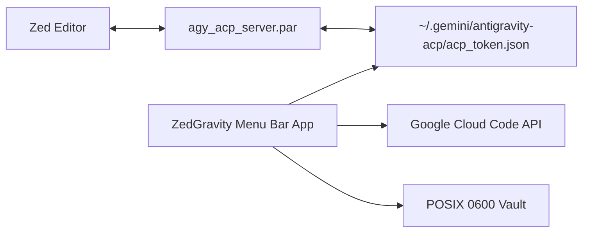

<p align="center">
  
</p>

<h1 align="center">ZedGravity</h1>

<p align="center">
  <strong>Native macOS Companion for Zed Editor & Google Antigravity ACP</strong><br/>
  Real-time quota monitoring, intelligent model auto-switching, and zero-prompt credential vaulting.
</p>

<p align="center">
  <a href="LICENSE"></a>
  <a href="https://apple.com/macos"></a>
  <a href="https://swift.org"></a>
  
  
</p>

---

## Overview

When building with AI in [Zed Editor](https://zed.dev), [Antigravity IDE](https://antigravity.google), or [Ghostex](https://ghostex.sh) / **Antigravity CLI (`agy`)**, developers encounter two major pain points:
1. **Hidden Quota Depletion**: Using heavy reasoning models like **Claude 3.7 Sonnet**, **Claude 3.5 Opus**, or **Gemini 2.5 Pro** burns through quota limits with no visual warning until prompts fail.
2. **Disruptive Account Switching**: Switching accounts manually requires editing config files or clearing tokens, often disrupting open editor windows or terminal sessions.

**ZedGravity** runs natively in your macOS Menu Bar, giving you continuous live visibility into Gemini, Claude/GPT, and image generation quotas. When an account runs low, its intelligent auto-switcher seamlessly hot-reloads credentials for **Zed ACP**, **Antigravity CLI / Ghostex**, and **Antigravity IDE** in the background.

---

## Key Features

- **Dynamic macOS Menu Bar Widget**: Displays live remaining percentages side-by-side (`G: 74% • C: 0% • Img: 74%`) following Apple Human Interface Guidelines.
- **Intelligent Quota Auto-Switch**: Automatically swaps credentials to the healthiest backup account when current quota falls $\le 5\%$.
  - Multi-Client Support: **Zed ACP**, **Antigravity CLI / Ghostex (`agy`)**, and **Antigravity IDE**.
  - Target Focus: Monitor **Claude / GPT Only**, **Gemini Only**, or **Both**.
- **Zero Chat Loss**: Uses atomic token updates and clean process signaling so Zed automatically respawns the ACP server without dropping active conversations.
- **Ghostex & Terminal Agent Ready**: Synchronizes `~/.gemini/antigravity-cli/antigravity-oauth-token`, `jetski-standalone-oauth-token`, and `google_accounts.json` with strict POSIX `0600` permissions.
- **Battery-Optimized Smart Sync**: Background polling refreshes *only* the active account being used, saving up to 85% CPU and network requests compared to legacy tools.
  - Profiles: *Balanced (60s)*, *Fast (15s)*, *Battery Saver (5m)*, or *Manual*.
- **Zero Password Prompts**: Credentials and refresh tokens are protected in a private local vault with strict POSIX `0600` permissions—eliminating repetitive macOS Keychain password dialogs.
- **1-Click Import**: Instantly migrates existing accounts and OAuth tokens from `~/.antigravity_tools` or local config files with zero setup required.
- **System Notifications**: Native macOS alert banners with sound when any monitored model enters critical quota thresholds or auto-switches.

---

## Requirements

| Requirement | Supported Version | Notes |
| :--- | :--- | :--- |
| **Operating System** | macOS 14.0+ (Sonoma, Sequoia) | Native Apple Silicon (M1/M2/M3/M4) & Intel |
| **Editor / Terminal** | [Zed Editor](https://zed.dev) (v0.150+), [Ghostex](https://ghostex.sh), Terminal | Supports Zed ACP, Ghostex (`zmx`), and `agy` |
| **ACP / CLI** | Antigravity CLI (`agy`, `antigravity acp`) | Standard Google Antigravity daemon & CLI |
| **Google Account** | Free or Google Cloud Code Pro | Direct OAuth2 token exchange |

---

## Quick Start & Installation

### Option 1: Install Pre-Built Binary (Recommended)

1. Clone or download the repository:
   ```bash
   git clone https://github.com/naenmad/ZedGravity.git
   cd ZedGravity
   ```

2. Build and install to `/Applications` in one command:
   ```bash
   ./scripts/build_app.sh -i
   ```

3. Launch **ZedGravity** from Spotlight (`Cmd + Space`) or your Applications folder.

---

## Zed Integration Guide

Zed connects to Google Antigravity via the **Agent Client Protocol**. To allow ZedGravity to manage credentials seamlessly:

1. Open Zed settings (`Cmd + ,` or edit `~/.config/zed/settings.json`).
2. Add or update the assistant server definition to include `"AGY_ACP_FORCE_FILE_STORAGE": "1"`:

```json
{
  "assistant": {
    "version": "2",
    "provider": {
      "name": "custom",
      "servers": {
        "antigravity-acp": {
          "command": "/Users/YOUR_USERNAME/.local/bin/antigravity",
          "args": ["acp"],
          "env": {
            "AGY_ACP_FORCE_FILE_STORAGE": "1"
          }
        }
      }
    }
  }
}
```

> [!TIP]
> For a full walkthrough of Zed configuration and troubleshooting, refer to [docs/ZED_INTEGRATION.md](docs/ZED_INTEGRATION.md).

---

## Architecture

ZedGravity is built 100% standalone with Swift and SwiftUI. It communicates directly with Google Cloud Code APIs using official OAuth token exchanges—no local proxy server daemons required.



For complete sequence diagrams, state machine flows, and component specs, see [docs/ARCHITECTURE.md](docs/ARCHITECTURE.md).

---

## Security & Privacy

ZedGravity is designed with local-first, zero-telemetry security guardrails:

- **Zero Telemetry**: No tracking, analytics, or third-party cloud relays.
- **Direct Communication**: Network calls route strictly between your local machine and `googleapis.com`.
- **Restricted Permissions**: Account tokens are stored at `~/Library/Application Support/ZedGravity/` with `0600` POSIX attributes (accessible exclusively by your macOS user).

Review our complete [Security Policy](SECURITY.md) for details.

---

## Contributing

Contributions, bug reports, and suggestions are welcome!

1. Check existing discussions in [GitHub Issues](https://github.com/naenmad/ZedGravity/issues).
2. Review our [Contributing Guide](CONTRIBUTING.md) and [Code of Conduct](CODE_OF_CONDUCT.md).
3. Submit a pull request with clear descriptions of your changes.

---

## License

This project is licensed under the **GNU General Public License v3.0 (GPLv3)**.  
See the [LICENSE](LICENSE) file for the full license text.

Copyright (c) 2026 [naenmad](https://github.com/naenmad).
